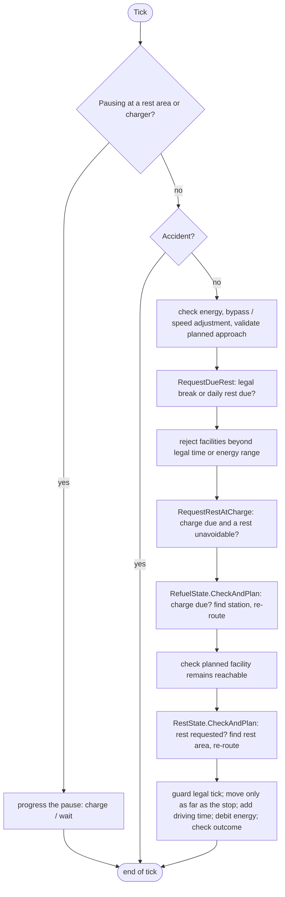
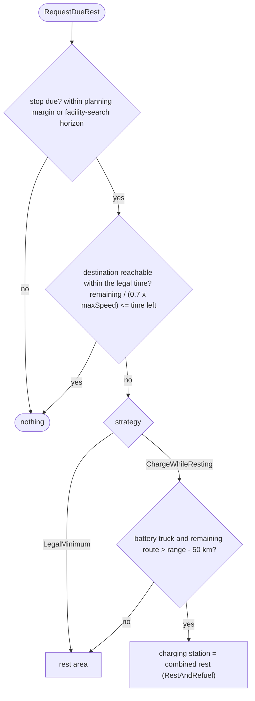
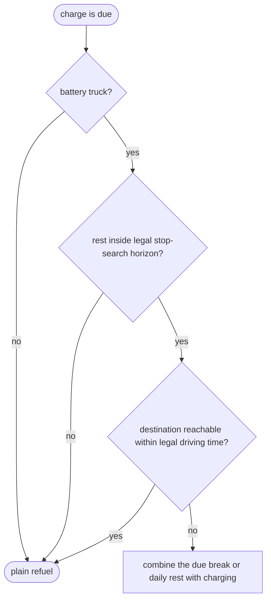
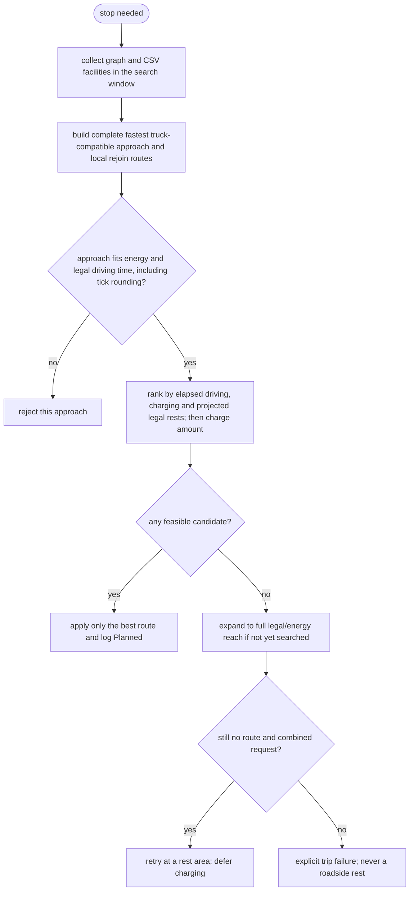

# Driving behaviour (macro layer)

The simulation has two layers:

| Layer | Question it answers | Where |
|---|---|---|
| **Micro** (physics) | How fast does the truck go, how much energy does a tick cost? | `SpeedAdjuster`, `RoadLoadFuelConsumptionStrategy`, `FuelConsumptionTracker`, `ChargingProfile` |
| **Macro** (behaviour) | When and where does the driver stop to charge, break or rest? | `SemiTruckDriver.Tick`, `IRestStrategy`, `RefuelState`, `RestState`, `StopState`, `DrivingTimeTracker` |

This document describes the macro layer: every decision, the rule behind it, and the constant or CSV column that tunes it.
All class paths are below `SOHModel/SemiTruck/Model/`. Constants live in `Driver/Utils/SemiTruckDriverConstants.cs`.

## 1. One tick of the driver

`SemiTruckDriver.Tick()` runs the following in this order. The order matters (see the note below the diagram).



Consumption is debited immediately after each movement. `RequestRestAtCharge` runs before
`RefuelState.CheckAndPlan`, so an unavoidable rest can be merged into the charge.

Only one stop is in flight at a time (`IsActive`, `HasRequest`, `HasCombinedRestRequest`).

While pausing, the truck is removed from the road network and re-inserted at the stop node when it resumes. Facilities have no capacity limit: any number of trucks can use the same rest area or charging station, and a parked truck never blocks the lane or makes a facility look occupied to others.

## 2. Stop types

| `RestStateType` | Facility | Ends when | Created by |
|---|---|---|---|
| `Rest` | rest area | fixed duration (`BreakDuration` / `DailyRestDuration`) | `RestState` |
| `Refuel` | charging / fuel station | target energy reached | `RefuelState` |
| `RestAndRefuel` | charging station | target energy reached **and** the rest duration is over | `RefuelState` with a combined rest |

All charging stops, including daily rests, use the target described in section 5.

## 3. Legal driving time (EU 561/2006)

`DrivingTimeTracker` counts driving time since the last break and since the last daily rest.

| Rule | Value | Constant |
|---|---|---|
| Break after | 4.5 h driving | `MaxDrivingBeforeBreak` |
| Break length | 45 min (15 + 30 split allowed, in that order) | `BreakDuration`, `BreakFirstPart`, `BreakSecondPart` |
| Daily driving | 9 h | `MaxDailyDriving` |
| Daily rest | duration defined by the model constant | `DailyRestDuration` |

Any stationary period, including a charge, is credited via `RegisterStop(duration)`:
`DailyRestDuration` or more resets the daily rest and the break, 45 min or more resets the break, and so on.
Not modelled: the two 10 h driving days per week, split daily rest, reduced-rest frequency restrictions, weekly limits.

A stop is **due** when the legal driving time left is at most the larger of the planning margin
(`restPlanningMarginMinutes`, default 30 min) and the estimated time to cover the 100 km facility-search horizon.
The complete routed approach must fit the legal time left, including road speed limits, detours and tick rounding.
It is rechecked every driving tick. If no feasible facility exists, the trip fails explicitly; no roadside rest is created.

## 4. Rest strategies (`restStrategy` column)

`IRestStrategy` decides *which facility* serves a due rest, and whether a rest is merged into a charge.



| Strategy | Behaviour |
|---|---|
| `LegalMinimum` | Rests at rest areas, minimizing estimated elapsed time; equally costly rests are taken later. |
| `ChargeWhileResting` | Like `LegalMinimum`, but uses a charging station whenever a charge is unavoidable before the destination, hiding the charging time in the rest. |

If no charger can be reached legally with the available energy, a combined-stop request falls back to a rest area.
Charging is deferred, not the required rest. The optional arrival reserve never excludes an otherwise reachable charger.
A short break is preferred over daily rest when the remaining drive fits the daily driving budget after that break.
Otherwise a due break is upgraded to the daily rest when that does not increase the projected stationary time
(strictly less at a rest area, equal suffices at a charger), so a break is not followed shortly by a daily rest.

Planning speed (`PlanningSpeed.Conservative`): `PlanningSpeedFraction` (0.7) times `maxSpeed`, deliberately
pessimistic. `maxSpeed` here excludes the local incline reduction (`SemiTruck.PlanningMaxSpeed`), so a climb does not
cancel an accepted plan. Projections of the total trip time (daily-rest merge, section 6) use
`PlanningSpeed.Expected` (`ExpectedSpeedFraction`, 0.9) instead. Routed estimates (`RouteEstimate`) cap the speed by
each edge's limit (`PlanningSpeed.OnEdge`).

Coverage trigger: besides the regular trigger, a required rest is planned when the truck is about to pass
(`RestCoverageGuardMeters`, 5 km) the last route position with a rest facility within its legal reach, so sparse
corridors do not leave it without a legal stop.

## 5. When to charge and how much

Trigger (`RefuelState.IsChargeDue`), evaluated every tick:

```
range = energy / planning consumption                       (FuelConsumptionTracker.PlanningRangeKm)
trigger if  range < RefuelStationSearchRadius + RouteChargeReserveKm      (100 km + 50 km = 150 km)
       and  remaining route > range
```

- *Planning consumption* is the larger of the nominal `fuelConsumptionPer100km` and the consumption observed so far (trusted after `MinObservedDistanceKm` = 20 km). A lighter truck therefore does not lower the plan below the nominal value.
- The 100 km term is the station search window: the truck must still be able to reach a station anywhere inside it.

Charge target (`RefuelState.RouteBasedTargetSoc`, battery trucks without `chargeTargetSoc`):

```
needed = consumption x (remaining route x RouteChargeSafetyFactor (1.1) + RouteChargeReserveKm (50))
target = needed / capacity       if 0 < target <= 1
         default (80 % battery)  otherwise: the route needs more than a full battery, another stop follows
```

While a combined rest is still running, a battery whose route needs more than the default target keeps charging
towards 100 %, which costs no time. A fixed `chargeTargetSoc` in the CSV overrides the automatic target.

Reachability of a stop (`StopReachability.CanReach`) combines the legal driving time left with the energy check
(`FuelConsumptionTracker.CanCover`). The latter also requires
`consumption x distance + m g x elevation gain <= available energy` at every elevation sample of the approach
(descents credited at `DescentRecoveryFactor`, 0.5). Chargers keeping the 50 km arrival reserve rank first.
The charging power follows `ChargingProfile` (station power, truck `maxChargePowerKw`, taper near full).

## 6. Merging a rest into a charge

Two entry points create a combined rest (`RefuelState.RequestCombinedRest`):

1. **Rest due, charge needed anyway** (section 4): the rest becomes a charging stop, bounded by the legal reach.
2. **Charge due, rest also due** (`ChargeWhileRestingStrategy.RequirementAtCharge`, called from `RequestRestAtCharge`):



The charge itself is credited as stationary rest. If no rest is due yet but the destination cannot be reached in the
current driving day, the daily rest is merged into the charge when
`DailyRest + projected further rests <= Break + projected further rests` (projected at `ExpectedSpeedFraction`),
i.e. when taking it now does not increase the projected stationary time.

## 7. Where to stop (`StopState.PlanBestStop`)



The approach preserves the truck's current edge and position. From the same facility node, the planner compares
complete connectors to the departure junction and downstream nodes within 20 km along the original route.
It chooses the least-time connector plus original suffix (distance breaks ties), preserving the original
corridor beyond the rejoin rather than rerouting the entire remaining journey through unrelated roads.
No partial route or disconnected coordinate snap is accepted. Up to 8 road nodes within 500 m of the nearest one are
tried (closest first) as the facility node; nodes of the route itself are excluded. Failed candidates do not replace the active route.
A facility the network does not model (no off-route node within 150 m) but lying within 1 km of a route edge, e.g. a
service area beside the motorway, is entered from that edge without detour; the stop node is the nearer end of the
edge. After the stop, the truck continues on the edge leaving the stop node rather than re-driving the approach edge.
Charging-time estimates include station/vehicle power and taper; future breaks/rests use the current legal budgets.
This rolling-horizon ranking does not claim global optimality.

Facility lists: battery trucks use the charging list, other carriers the fuel list, rests use the rest area list.
Neighbour-country charging stations are appended if `resources/charging_stations_neighbors.csv` exists (see the README).

## 8. Tuning reference

| What you want to change | Where | Effect |
|---|---|---|
| Start energy | `FuelConsumptionTracker` (currently full) | timing of all stops |
| Arrival reserve at a stop | `RouteChargeReserveKm` (50) | later or earlier trigger, safer or riskier arrival |
| How far ahead a station is searched | `RefuelStationSearchRadius`, `RestAreaSearchRadius` (100 km) | initial search window; expanded to legal/energy reach if needed |
| Safety margin on the route energy | `RouteChargeSafetyFactor` (1.1) | charge target |
| Charge target | `chargeTargetSoc` column (0 = 80 % battery, 100 % otherwise) | stop duration, number of stops |
| Pessimism of the arrival check | `PlanningSpeedFraction` (0.7) | when a rest is judged unavoidable |
| Rest planning margin | `restPlanningMarginMinutes` column (default 30) | how early a rest is planned |
| Rest strategy | `restStrategy` column: `LegalMinimum`, `ChargeWhileResting` | sections 4 and 6 |
| Detour tolerance | `MaxFacilityDetourMeters` (10 km) | CSV facility ranking, never roadside fallback |
| Elevation credit on descents | `DescentRecoveryFactor` (0.5) | energy reachability on hilly approaches |
| Rest coverage guard | `RestCoverageGuardMeters` (5 km) | how early a rest is planned before the last reachable rest facility |
| Forward rejoin window | `ForwardRejoinLookaheadMeters` (20 km) | how far past the departure junction a facility detour may rejoin; original route preserved afterwards |
| Consumption floor for planning | `fuelConsumptionPer100km` column | section 5 |

New strategies: implement `IRestStrategy` (`NextRequirement`, `RequirementAtCharge`), add a `RestStrategyType` value and map it in `SemiTruck.InitializeRestStrategy`.

## 9. Reading a run

The `rests` table logs every stop (`Planned`, `Start`, `End`) with tick, position, energy and remaining route; `road_load` and `fuel_consumption` hold the micro layer.
`Planned` is emitted only after a facility route is accepted, not for rejected candidates or failed searches.
A combined-stop search that falls back to a rest area therefore records only the accepted `Rest` decision.
Terminal stop-planning failures print the number of candidate approaches, search window and route rejection counts,
distinguishing missing facilities from incompatible approaches, energy/time limits and unavailable rejoin routes.
`truck_trips` records completion/failure.
See `facility_metrics.sql` for stop and stranded-truck counts.

```sql
select tick, statetype, eventtype, round(currentfuel::numeric,1) as kwh, round(remainingroutemeters::numeric) as remaining_m
from rests order by id;
```

- `Planned` shortly before `Start` at the same place: the first facility ahead was taken (no reach limit), or the planned one failed to route and was replaced.
- Energy at `Planned` of about 150 km times the planning consumption: the trigger of section 5.
- `RestAndRefuel` duration at least `DailyRestDuration`: a combined daily rest; charge amount alone does not identify it.
- Console output is reserved for failures and actual errors, not normal planning attempts or stop transitions.
