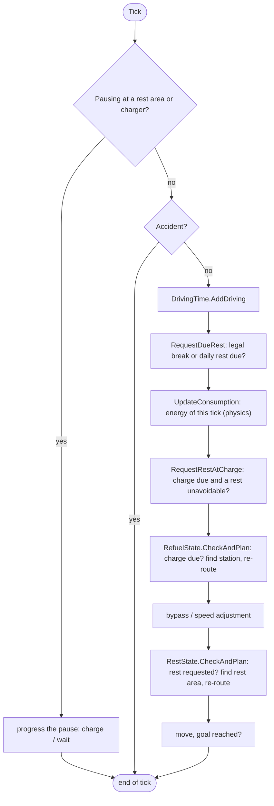
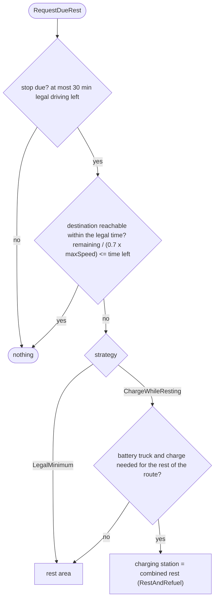
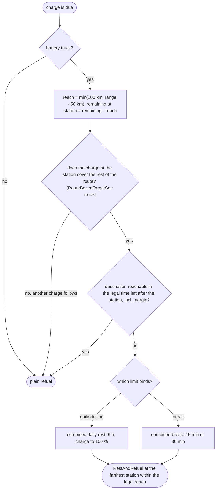
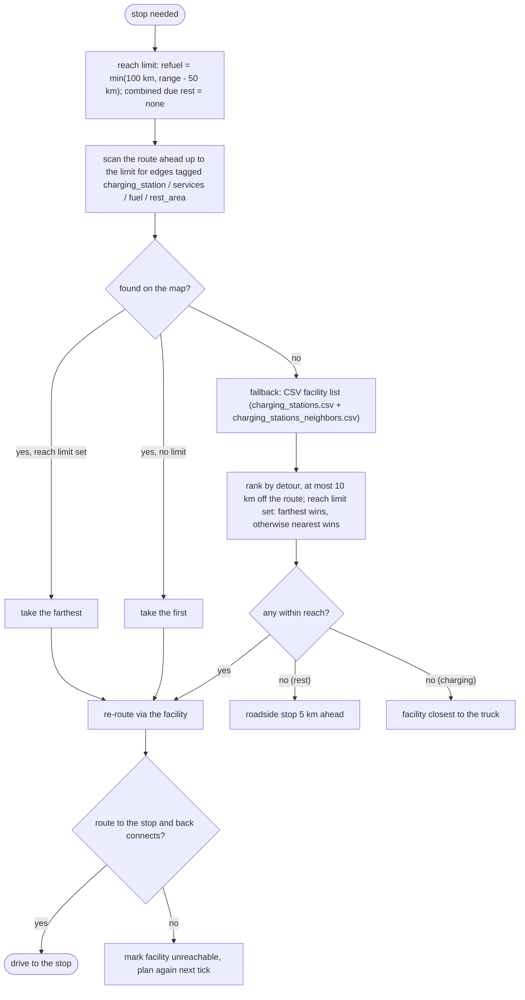

# Driving behaviour (macro layer)

The simulation has two layers:

| Layer | Question it answers | Where |
|---|---|---|
| **Micro** (physics) | How fast does the truck go, how much energy does a tick cost? | `SpeedAdjuster`, `RoadLoadFuelConsumptionStrategy`, `FuelConsumptionTracker`, `ChargingProfile` |
| **Macro** (behaviour) | When and where does the driver stop to charge, break or rest? | `SemiTruckDriver.Tick`, `IRestStrategy`, `RefuelState`, `RestState`, `StopState`, `DrivingTimeTracker` |

This document describes the macro layer: every decision, the rule behind it, and the constant or CSV column that tunes it.
All class paths are below `SOHModel/SemiTruck/Model/`. Constants live in `Driver/Utils/SemiTruckDriverConstants.cs`.

## 1. One tick of the driver

`SemiTruckDriver.Tick()` runs the following in this order. The order matters (see the note below the diagram).



> `RequestRestAtCharge` must run **after** the consumption update and **before** `RefuelState.CheckAndPlan`:
> the tick in which the range falls below the trigger is also the tick in which the stop is planned, so a rest that
> should be merged into the charge has to be requested first.

Only one stop is in flight at a time (`IsActive`, `HasRequest`, `HasCombinedRestRequest`).

While pausing, the truck is removed from the road network and re-inserted at the stop node when it resumes. Facilities have no capacity limit: any number of trucks can use the same rest area or charging station, and a parked truck never blocks the lane or makes a facility look occupied to others.

## 2. Stop types

| `RestStateType` | Facility | Ends when | Created by |
|---|---|---|---|
| `Rest` | rest area (or roadside) | fixed duration (break 45 min / daily rest 9 h) | `RestState` |
| `Refuel` | charging / fuel station | target energy reached | `RefuelState` |
| `RestAndRefuel` | charging station | target energy reached **and** the rest duration is over | `RefuelState` with a combined rest |

During a `RestAndRefuel` that is a daily rest, the battery is charged to 100 %. Otherwise the target is described in section 5.

## 3. Legal driving time (EU 561/2006)

`DrivingTimeTracker` counts driving time since the last break and since the last daily rest.

| Rule | Value | Constant |
|---|---|---|
| Break after | 4.5 h driving | `MaxDrivingBeforeBreak` |
| Break length | 45 min (15 + 30 split allowed, in that order) | `BreakDuration`, `BreakFirstPart`, `BreakSecondPart` |
| Daily driving | 9 h | `MaxDailyDriving` |
| Daily rest | 9 h | `DailyRestDuration` |

Any stationary period, including a charge, is credited via `RegisterStop(duration)`: 9 h or more resets the daily rest and the break, 45 min or more resets the break, and so on.
Not modelled: the two 10 h driving days per week, split daily rest, weekly limits.

A stop is **due** when the legal driving time left is at most the planning margin (`restPlanningMarginMinutes`, default 30 min).

## 4. Rest strategies (`restStrategy` column)

`IRestStrategy` decides *which facility* serves a due rest, and whether a rest is merged into a charge.



| Strategy | Behaviour |
|---|---|
| `LegalMinimum` | Rests as late as legally possible, always at a rest area. |
| `ChargeWhileResting` | Like `LegalMinimum`, but rests at a charging station if the truck has to charge anyway (same criterion as section 5). Additionally merges a rest into the last charge, see section 6. |

Planning speed: `PlanningSpeedFraction` (0.7) times `maxSpeed`, deliberately pessimistic.

## 5. When to charge and how much

Trigger (`RefuelState.IsChargeDue`), evaluated every tick:

```
range = energy / planning consumption                       (FuelConsumptionTracker.PlanningRangeKm)
trigger if  range < RefuelStationSearchRadius + RouteChargeReserveKm      (100 km + 50 km = 150 km)
       and  remaining route > range
```

- *Planning consumption* is the larger of the nominal `fuelConsumptionPer100km` and the consumption observed so far (trusted after `MinObservedDistanceKm` = 20 km). A lighter truck therefore does not lower the plan below the nominal value.
- The 100 km term is the station search window: the truck must still be able to reach a station anywhere inside it.

Charge target (`RefuelState.RouteBasedTargetSoc`, battery trucks without `chargeTargetSoc`):

```
needed = consumption x (remaining route x RouteChargeSafetyFactor (1.1) + RouteChargeReserveKm (50))
target = needed / capacity       if 0 < target <= 1
         default (80 % battery)  otherwise: the route needs more than a full battery, another stop follows
```

A daily rest overrides the target with 100 %. A fixed `chargeTargetSoc` in the CSV overrides everything else.
The charging power follows `ChargingProfile` (station power, truck `maxChargePowerKw`, taper near full).

## 6. Merging a rest into a charge

Two entry points create a combined rest (`RefuelState.RequestCombinedRest`):

1. **Rest due, charge needed anyway** (section 4): the rest becomes a charging stop. The station is the *nearest* one ahead, because the legal limit is close.
2. **Charge due, rest unavoidable** (`ChargeWhileRestingStrategy.RequirementAtCharge`, called from `RequestRestAtCharge`):



Reasoning: a driver who knows that the rest limit will be hit before the destination takes the rest at the charger he needs anyway, instead of a separate rest area stop shortly before arrival.

## 7. Where to stop (`StopState.PlanStop`)



Facility lists: battery trucks use the charging list, other carriers the fuel list, rests use the rest area list.
Neighbour-country charging stations are appended if `resources/charging_stations_neighbors.csv` exists (see the README).

## 8. Tuning reference

| What you want to change | Where | Effect |
|---|---|---|
| Start energy | `SemiTruckDriver.Init` (currently 90 %, marked `TEST`) | timing of all stops |
| Arrival reserve at a stop | `RouteChargeReserveKm` (50) | later or earlier trigger, safer or riskier arrival |
| How far ahead a station is searched | `RefuelStationSearchRadius`, `RestAreaSearchRadius` (100 km) | trigger range and maximum reach |
| Safety margin on the route energy | `RouteChargeSafetyFactor` (1.1) | charge target |
| Charge target | `chargeTargetSoc` column (0 = 80 % battery, 100 % otherwise) | stop duration, number of stops |
| Pessimism of the arrival check | `PlanningSpeedFraction` (0.7) | when a rest is judged unavoidable |
| Rest planning margin | `restPlanningMarginMinutes` column (default 30) | how early a rest is planned |
| Rest strategy | `restStrategy` column: `LegalMinimum`, `ChargeWhileResting` | sections 4 and 6 |
| Detour tolerance | `MaxFacilityDetourMeters` (10 km), `RoadsideStopLookaheadMeters` (5 km) | CSV facility ranking |
| Consumption floor for planning | `fuelConsumptionPer100km` column | section 5 |

New strategies: implement `IRestStrategy` (`NextRequirement`, `RequirementAtCharge`), add a `RestStrategyType` value and map it in `SemiTruck.InitializeRestStrategy`.

## 9. Reading a run

The `rests` table logs every stop (`Planned`, `Start`, `End`) with tick, position, energy and remaining route; `road_load` and `fuel_consumption` hold the micro layer.

```sql
select tick, statetype, eventtype, round(currentfuel::numeric,1) as kwh, round(remainingroutemeters::numeric) as remaining_m
from rests order by id;
```

- `Planned` shortly before `Start` at the same place: the first facility ahead was taken (no reach limit), or the planned one failed to route and was replaced.
- Energy at `Planned` of about 150 km times the planning consumption: the trigger of section 5.
- `RestAndRefuel` with `End` energy 100 %: a combined daily rest.
